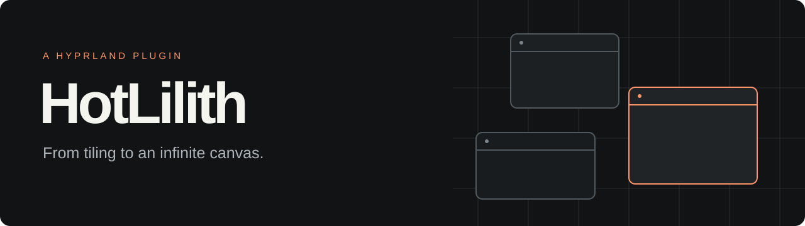
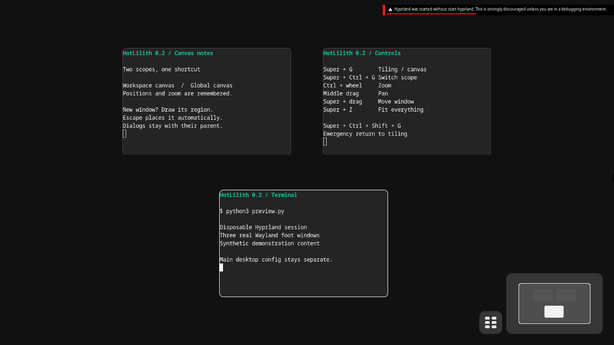

<p align="center">
  
</p>

<p align="center">
  Move beyond the grid. Arrange real application windows on a canvas,<br>
  pan and zoom, then return to your Hyprland tiling layout with a shortcut.
</p>

<p align="center">
  <a href="https://hypr.land"></a>
  
  
  <a href="LICENSE"></a>
</p>

<p align="center">
  <a href="#installation">Installation</a> ·
  <a href="#controls">Controls</a> ·
  <a href="#your-theme-your-shortcuts">Customization</a> ·
  <a href="README.ru.md">Русский</a>
</p>

---

## Your windows, with room to move

- **Tiling ↔ canvas.** Keep your applications open and return to native tiling when you need it.
- **Two scopes.** Use the current workspace or bring ordinary workspaces onto one canvas. Each scope remembers its own arrangement and camera.
- **Pan, zoom, arrange.** Zoom from 10% to 200%, move with inertia and align windows with magnetic guides.
- **Draw a place for new windows.** Select an area as each window opens. Dialogs stay with their parent; Escape places a waiting window automatically.
- **Keep your desktop.** Window decorations and camera animations follow your Hyprland settings. Serpantinum is not required; one monitor is enough.

<details>
<summary>See the canvas</summary>



</details>

## Installation

You need **Hyprland 0.57.0**, a **Lua configuration** and the **dwindle** layout. Build inside your running Hyprland session, with matching development headers and **hyprutils 0.14.3 or newer**.

<details>
<summary>Build dependencies</summary>

- GCC 15+ with `#embed` support, Make, Git, pkg-config, Python 3 and binutils.
- Hyprland development headers, Lua 5.4, hyprgraphics, Pango/Cairo, pixman, libdrm, libinput, libudev, Wayland server and xkbcommon.
- Optional: `foot` for the disposable preview.

The library names used by pkg-config are listed in [source/Makefile](source/Makefile). There is no prebuilt `.so`: the plugin must match your compositor's ABI.

</details>

```bash
git clone https://github.com/slayPunk/HotLilith.git
cd HotLilith
bash build.sh
python3 install.py --enable
```

The installer backs up your Lua config and adds the plugin and settings module. It **does not add or remove key bindings**. If Hyprland does not reload automatically, run `hyprctl reload`.

Files are installed under `${XDG_DATA_HOME:-$HOME/.local/share}/hotlilith`. The default config is `${XDG_CONFIG_HOME:-$HOME/.config}/hypr/hyprland.lua`; use `--config PATH` or `--target PATH` for other locations.

<details>
<summary>Try a separate preview before connecting it</summary>

After building, run:

```bash
python3 preview.py
```

This opens a separate Hyprland window with demonstration applications. Close that window or press **Super+Shift+Escape inside it** to exit. Your desktop configuration stays separate.

</details>

## Controls

### Choose your shortcuts

The keyboard shortcuts below are provided by an **optional example**. Review and edit the installed `config/bindings.example.lua` to avoid conflicts, then add this **after the HotLilith connection block** in your `hyprland.lua`:

```lua
local data = os.getenv("XDG_DATA_HOME") or (os.getenv("HOME") .. "/.local/share")
dofile(data .. "/hotlilith/config/bindings.example.lua")
```

### Everyday actions

| Action | Control |
| :--- | :--- |
| Tiling ↔ canvas | <kbd>Super</kbd> + <kbd>G</kbd> |
| Current workspace ↔ global canvas | <kbd>Super</kbd> + <kbd>Ctrl</kbd> + <kbd>G</kbd> |
| Emergency return to tiling | <kbd>Super</kbd> + <kbd>Ctrl</kbd> + <kbd>Shift</kbd> + <kbd>G</kbd> |
| Pan the canvas | Middle drag, or left drag on empty background |
| Zoom around the pointer | Wheel on the background; <kbd>Ctrl</kbd> + wheel or <kbd>Super</kbd> + wheel over a window |
| Move / resize a window | Your existing Super + left / right drag bindings |
| Fit all windows | <kbd>Super</kbd> + <kbd>Z</kbd> |
| Overview ↔ 100% | <kbd>Super</kbd> + <kbd>Alt</kbd> + <kbd>G</kbd> |
| Place a waiting window automatically | <kbd>Escape</kbd> |

Ordinary scrolling over a window stays with the application. Mouse move/resize bindings are not installed by HotLilith; examples are included as comments in the bindings file.

<details>
<summary>More keyboard controls</summary>

| Action | Shortcut |
| :--- | :--- |
| Focus a neighbouring window | Super + Ctrl + Alt + arrows |
| Move the camera | Super + Alt + arrows |
| Zoom in / out | Super + Ctrl + `=` / `-` |
| Return to the canvas origin at 100% | Super + Ctrl + Home |
| Centre the active window | Super + Ctrl + C |
| Draw an area before opening an application | Super + Ctrl + N |
| Toggle manual pointer capture | Super + Ctrl + P |
| Release a captured pointer | Super + Ctrl + Escape |

When no window is waiting, Escape cancels a region or stops inertia. The scope shortcut selects the next scope if the canvas is closed.

</details>

### Opening and arranging windows

Enter the canvas to arrange existing windows freely with gaps between them. New standalone windows wait for you to **drag an area on the canvas**; multiple windows are placed one at a time. Press Escape to place the current waiting window automatically. File dialogs and other transient dialogs open with their parent.

Dragging a window across the **global canvas does not move it to another workspace**. Use your normal Hyprland workspace commands for that. Switching workspaces closes a workspace-only canvas.

Window positions, sizes, camera and zoom are remembered separately for each scope. Returning to tiling restores the previous dwindle tree when its window membership is unchanged.

## Your theme, your shortcuts

HotLilith follows native window borders, gradients, rounding, opacity and shadows. Camera motion inherits `windowsMove`; disabled desktop animations remain disabled. Selection and minimap colors follow your active/inactive border colors.

For explicit canvas colors, add an override **after** the settings module:

```lua
hl.config({plugin={spatialoverview={canvas={
  accent = "rgb(ff9566)",
  panel_color = "rgb(202426)",
}}}})
```

These colors are optional. HotLilith does not replace your theme, panel, launcher or workspace bindings. See [config/canvas.lua](config/canvas.lua) for the preset and [config/bindings.example.lua](config/bindings.example.lua) for shortcut examples.

<details>
<summary>Layout memory</summary>

Memory is stored in `${XDG_STATE_HOME:-$HOME/.local/state}/hotlilit/canvas-memory-v2.txt` with permissions `0600`. It contains application classes and window titles; changing titles may require manual placement. Set `remember_layout = false` in your canvas settings to disable it. Delete the file while the canvas is closed to reset saved arrangements.

</details>

## Update or disconnect

Before replacing a loaded plugin, disconnect it:

```bash
python3 install.py --remove
```

Log out of Hyprland and back in. After updating Hyprland itself, a newer HotLilith version may be needed too. Then rebuild and reconnect:

```bash
git pull --ff-only
bash build.sh
python3 install.py --enable
```

To disconnect HotLilith:

```bash
python3 install.py --remove
```

This closes the canvas and removes the managed connection block. Installed files and config backups remain. If you added the optional bindings include, remove that line from your config too.

## Before you use it

- Window groups must be ungrouped before entering the canvas. Pinned windows and special workspaces stay outside it.
- A changed set of windows produces a new tiled layout rather than the exact old split tree.
- Game fullscreen and pointer capture depend on the application and runtime. Borderless fullscreen can have display/input problems; release capture with **Super+Ctrl+Escape** if needed.
- Multi-monitor and hotplug behavior may vary. Start with a single-monitor setup.

## Credits

Maintained by [slayPunk](https://github.com/slayPunk). Inspired by [Lilith](https://github.com/ohto121/lilith), built on the [Phantomat](https://github.com/kaolti/phantomat) renderer.

Bug report or feedback - [dm me on Telegram](t.me/ashwagandha4)

[BSD-3-Clause](LICENSE) · [Attribution](NOTICE.md) · [Upstream sources](UPSTREAM.md)
