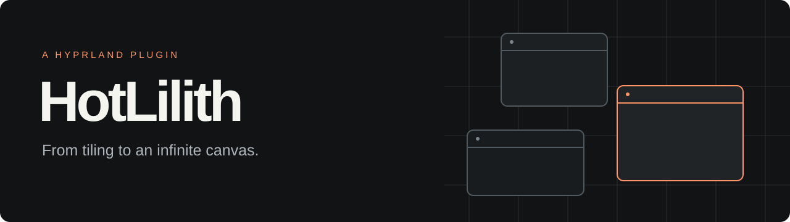
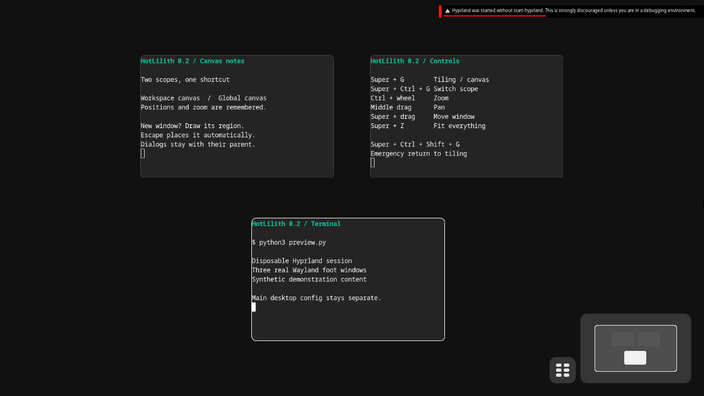

<p align="center">
  
</p>

<p align="center">
  Больше пространства для ваших окон.<br>
  Расставляйте приложения на холсте, перемещайте камеру и меняйте масштаб.<br>
  Один хоткей — и вы снова в тайлинге Hyprland.
</p>

<p align="center">
  <a href="https://hypr.land"></a>
  
  
  <a href="LICENSE"></a>
</p>

<p align="center">
  <a href="#установка">Установка</a> ·
  <a href="#управление">Управление</a> ·
  <a href="#оформление-и-настройки">Настройки</a> ·
  <a href="README.md">English</a>
</p>

---

## Окна за пределами сетки

- **Тайлинг ↔ холст.** Приложения остаются открытыми, а вернуться в привычную раскладку можно хоткеем.
- **Два режима.** Холст текущего рабочего стола или общий холст обычных столов. У каждого — свои расположение окон, камера и масштаб.
- **Свободное перемещение.** Масштаб 10–200%, инерция окон и камеры, магнитные направляющие для выравнивания.
- **Место для нового окна.** Нарисуйте область после запуска приложения. Escape разместит ожидающее окно автоматически, а диалоги откроются у родителя.
- **Ваш рабочий стол.** Оформление окон и анимации наследуются из Hyprland. Serpantinum не требуется, достаточно одного монитора.

<details>
<summary>Посмотреть холст</summary>



</details>

## Установка

Нужны **Hyprland 0.57.0**, **Lua-конфиг** и раскладка **dwindle**. Собирайте плагин внутри работающего сеанса Hyprland с совпадающими заголовками и **hyprutils 0.14.3 или новее**.

<details>
<summary>Зависимости для сборки</summary>

- GCC 15+ с поддержкой `#embed`, Make, Git, pkg-config, Python 3 и binutils.
- Заголовки Hyprland, Lua 5.4, hyprgraphics, Pango/Cairo, pixman, libdrm, libinput, libudev, Wayland server и xkbcommon.
- Необязательно: `foot` для отдельного предпросмотра.

Имена библиотек для pkg-config перечислены в [source/Makefile](source/Makefile). Готового `.so` нет: сборка должна соответствовать ABI вашего композитора.

</details>

```bash
git clone https://github.com/slayPunk/HotLilith.git
cd HotLilith
bash build.sh
python3 install.py --enable
```

Установщик сохраняет резервную копию Lua-конфига и добавляет плагин с модулем настроек. **Хоткеи не назначаются и не удаляются.** Если конфиг не перечитался автоматически, выполните `hyprctl reload`.

Файлы устанавливаются в `${XDG_DATA_HOME:-$HOME/.local/share}/hotlilith`. Конфиг по умолчанию — `${XDG_CONFIG_HOME:-$HOME/.config}/hypr/hyprland.lua`. Для других путей доступны `--config PATH` и `--target PATH`.

<details>
<summary>Сначала открыть отдельный предпросмотр</summary>

После сборки выполните:

```bash
python3 preview.py
```

Откроется отдельное окно Hyprland с демонстрационными приложениями. Закройте его или нажмите **Super+Shift+Escape внутри предпросмотра**. Настройки вашего рабочего стола остаются отдельно.

</details>

## Управление

### Подключить свои хоткеи

Клавиатурные сочетания ниже относятся к **необязательному примеру**. Проверьте и отредактируйте установленный `config/bindings.example.lua`, чтобы избежать конфликтов. Затем добавьте **после блока подключения HotLilith** в `hyprland.lua`:

```lua
local data = os.getenv("XDG_DATA_HOME") or (os.getenv("HOME") .. "/.local/share")
dofile(data .. "/hotlilith/config/bindings.example.lua")
```

### Основные действия

| Действие | Управление |
| :--- | :--- |
| Тайлинг ↔ холст | <kbd>Super</kbd> + <kbd>G</kbd> |
| Текущий стол ↔ общий холст | <kbd>Super</kbd> + <kbd>Ctrl</kbd> + <kbd>G</kbd> |
| Аварийный возврат в тайлинг | <kbd>Super</kbd> + <kbd>Ctrl</kbd> + <kbd>Shift</kbd> + <kbd>G</kbd> |
| Переместить камеру | Средняя кнопка или ЛКМ по пустому фону |
| Масштаб около указателя | Колесо на фоне; <kbd>Ctrl</kbd> + колесо или <kbd>Super</kbd> + колесо над окном |
| Переместить / растянуть окно | Ваши существующие Super + ЛКМ / ПКМ |
| Вместить все окна | <kbd>Super</kbd> + <kbd>Z</kbd> |
| Обзор ↔ 100% | <kbd>Super</kbd> + <kbd>Alt</kbd> + <kbd>G</kbd> |
| Автоматически разместить ожидающее окно | <kbd>Escape</kbd> |

Обычная прокрутка над окном передаётся приложению. Привязки мыши для перемещения и изменения размера HotLilith не устанавливает: примеры оставлены комментариями в файле хоткеев.

<details>
<summary>Дополнительные сочетания</summary>

| Действие | Хоткей |
| :--- | :--- |
| Выбрать соседнее окно | Super + Ctrl + Alt + стрелки |
| Переместить камеру | Super + Alt + стрелки |
| Приблизить / отдалить | Super + Ctrl + `=` / `-` |
| Вернуться в начало холста, 100% | Super + Ctrl + Home |
| Центрировать активное окно | Super + Ctrl + C |
| Нарисовать область до запуска приложения | Super + Ctrl + N |
| Включить / выключить ручной захват мыши | Super + Ctrl + P |
| Освободить захваченную мышь | Super + Ctrl + Escape |

Если ожидающих окон нет, Escape отменяет область или останавливает инерцию. При закрытом холсте хоткей смены режима выбирает область следующего входа.

</details>

### Открывать и расставлять окна

При первом входе уже открытые окна свободно раскладываются с промежутками. Каждое новое самостоятельное окно ждёт, пока вы **нарисуете для него область на холсте**. Несколько окон размещаются по очереди; Escape автоматически размещает текущее. Диалоги, включая сохранение файлов, открываются у родителя.

Перемещение в **общем холсте не меняет рабочий стол окна**. Для этого используйте обычные команды Hyprland. При переключении рабочего стола локальный холст закрывается.

Позиции, размеры, камера и масштаб запоминаются отдельно для каждого холста. Возврат в тайлинг восстанавливает прежнее дерево dwindle, если состав окон не изменился. Подробности — в [инструкции по управлению](docs/canvas.md).

## Оформление и настройки

Рамки, градиенты, скругления, прозрачность и тени сохраняют нативное оформление Hyprland. Камера наследует `windowsMove`; глобально отключённые анимации остаются отключёнными. Выделение и миникарта используют цвета активной и неактивной рамки.

Для своих цветов добавьте блок **после** модуля настроек:

```lua
hl.config({plugin={spatialoverview={canvas={
  accent = "rgb(ff9566)",
  panel_color = "rgb(202426)",
}}}})
```

Это необязательные переопределения. HotLilith не заменяет тему, панель, лаунчер и управление рабочими столами. Настройки находятся в [config/canvas.lua](config/canvas.lua), пример хоткеев — в [config/bindings.example.lua](config/bindings.example.lua).

<details>
<summary>Память расположения окон</summary>

Память хранится в `${XDG_STATE_HOME:-$HOME/.local/state}/hotlilit/canvas-memory-v2.txt` с правами `0600`. Файл содержит классы и заголовки окон; изменившиеся заголовки могут потребовать ручной расстановки. Для отключения задайте `remember_layout = false`. Для сброса удалите файл при закрытом холсте.

</details>

## Обновление и отключение

Перед заменой загруженного плагина отключите его:

```bash
python3 install.py --remove
```

Выйдите из сеанса Hyprland и войдите снова. После обновления самого Hyprland может понадобиться новая версия исходников HotLilith. Затем:

```bash
git pull --ff-only
bash build.sh
python3 install.py --enable
```

Для обычного отключения достаточно `python3 install.py --remove`: холст закроется, помеченный блок подключения удалится. Файлы и резервные копии останутся. Если вы добавляли строку подключения необязательных хоткеев, удалите её из конфига тоже.

## Перед использованием

- Перед входом разгруппируйте окна. Закреплённые окна и специальные столы не входят в холст.
- При изменившемся составе окон создаётся корректный новый тайлинг вместо точного прежнего дерева разбиения.
- Полноэкранный режим и захват мыши зависят от игры и среды запуска. В режиме без рамки возможны проблемы с изображением и вводом. Для освобождения захвата используйте **Super+Ctrl+Escape**.
- Поведение нескольких мониторов и hotplug может отличаться. Начните с одного монитора.

## Авторство

Разрабатывает [slayPunk](https://github.com/slayPunk). Идея вдохновлена [Lilith](https://github.com/ohto121/lilith), рендерер основан на [Phantomat](https://github.com/kaolti/phantomat).

[BSD-3-Clause](LICENSE) · [Авторство компонентов](NOTICE.md) · [Источники](UPSTREAM.md)
